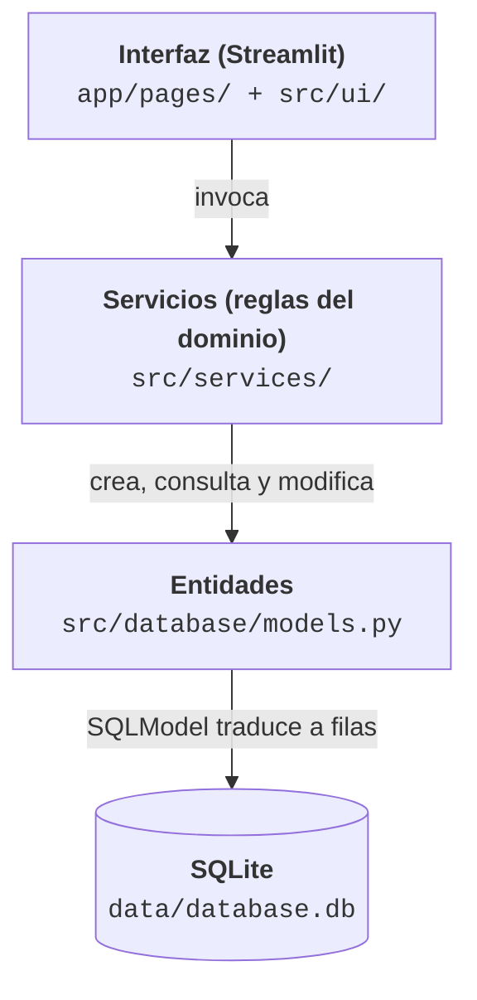
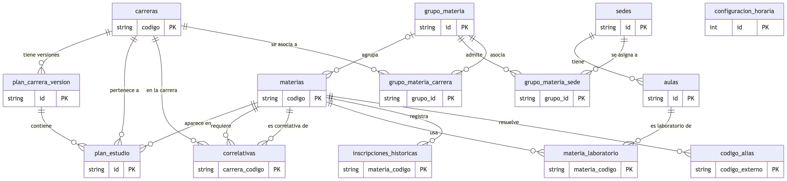
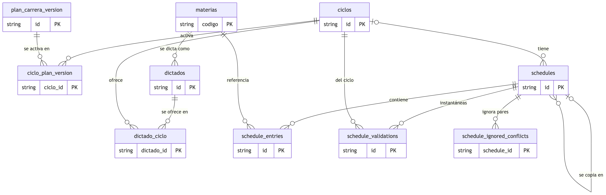
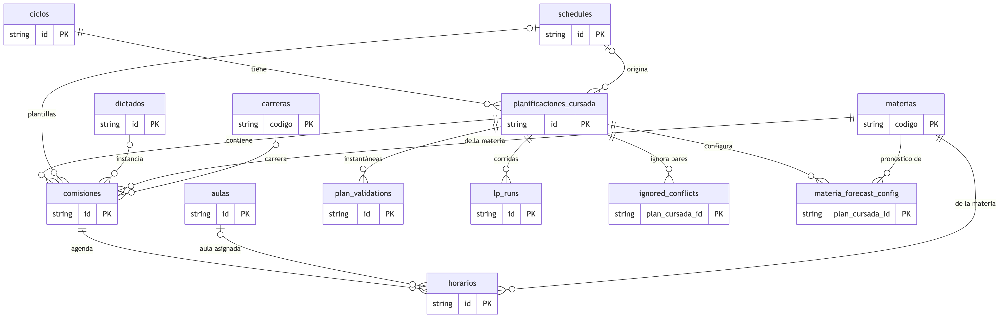
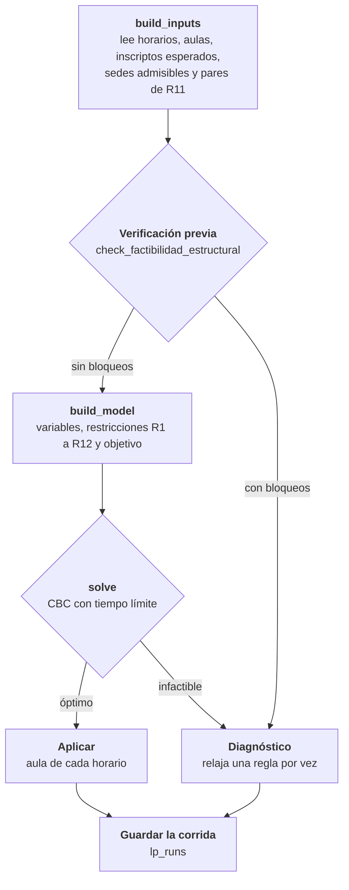

# Anexo A: Documentación técnica

Este anexo resume los aspectos técnicos del sistema que el informe
menciona sin detallar: cómo está organizado el código, qué guarda la
base de datos, cómo se arma y se resuelve el programa lineal, qué se
valida y cómo se distribuye la aplicación. Es una guía para orientarse
en el repositorio, no una documentación exhaustiva: cada sección remite
al archivo donde está el detalle.

- **Repositorio**: https://github.com/l-antonelli/gestor-aulas
- **Versión descripta**: 0.13.0.
- **Documentación completa**: carpeta `project/` del repositorio
  (índice en `project/README.md`).

El planteo matemático del programa lineal está en el Anexo B y el uso
de la aplicación, en el manual de usuario (Anexo C).

## 1. El repositorio

<!-- tabla: Carpetas del repositorio {#tab:a-carpetas} -->
| Carpeta | Contenido |
| :------------------- | :------------------------------------------------------------ |
| `app/` | Aplicación Streamlit: `main.py` (inicio) y una página por módulo en `app/pages/` (Materias, Aulas, Carreras, Ciclos, Cursada, Cronogramas, Inscriptos, Historial). |
| `src/database/` | Modelo de datos (`models.py`), conexión y migraciones (`connection.py`), altas, bajas y modificaciones genéricas (`crud.py`). |
| `src/services/` | Reglas del dominio: validaciones, generación del plan, pronóstico, asignador de aulas, importación y exportación. |
| `src/ui/` | Componentes de interfaz reutilizables (calendarios, paneles de validación, panel del asignador). |
| `src/domain/` | Versiones inmutables de las entidades principales, con validadores de invariantes. |
| `data/` | Base SQLite (`database.db`) y planillas de carga inicial (`input/`). |
| `scripts/` | Carga inicial, armado del ZIP portable, exportación del informe y sincronización con Google Drive. |
| `tests/` | Pruebas automatizadas (`pytest`). |
| `project/` | Documentación: `0. Planteo/` (dominio y supuestos), `1. Diseño/` (modelo de datos y programa lineal), `2. Desarrollo/` (implementación, validaciones, distribución) e `Informe/`. |

Los documentos de `project/` que amplían este anexo son:

<!-- tabla: Documentación técnica del repositorio {#tab:a-docs} -->
| Documento | Qué amplía |
| :------------------------------------------------ | :---------------------------------------------- |
| `1. Diseño/asignacion-aulas-LP.md` | Planteo formal del programa lineal, restricción por restricción. |
| `2. Desarrollo/asignador_implementacion.md` | Cómo se arma, resuelve y diagnostica el modelo en el código. |
| `2. Desarrollo/asignador_guia_operativa.md` | Cómo elegir los parámetros del asignador. |
| `2. Desarrollo/VALIDACIONES.md` | Todas las validaciones del sistema, con su severidad. |
| `1. Diseño/modelo-planificacion-cursada.md` | El paso de cronograma a plan de cursada. |
| `1. Diseño/diagrama-entidades.md` | Entidades con sus atributos y políticas de borrado. |
| `2. Desarrollo/CARGA_DATOS_INICIALES.md` | Carga de la base desde las planillas de la facultad. |
| `2. Desarrollo/DISTRIBUCION.md` | Armado y distribución del ZIP portable. |

## 2. Pila tecnológica

<!-- tabla: Componentes de la pila tecnológica {#tab:a-pila} -->
| Componente | Uso |
| :-------------------- | :------------------------------------------------------------ |
| Python 3.11 / 3.12 | Lenguaje de todo el sistema. |
| Streamlit | Interfaz web local: cada página es un programa de Python que se vuelve a ejecutar ante cada acción del usuario. |
| SQLite | Base de datos en un único archivo, sin servidor. |
| SQLModel (Pydantic y SQLAlchemy) | Cada entidad se declara una sola vez como clase de Python: valida sus campos y es a la vez el mapeo de su tabla. |
| PuLP con CBC | Formulación del programa lineal entero y resolutor de código abierto que lo resuelve. |
| pandas y openpyxl | Lectura de las planillas de la facultad y exportación de cronogramas a Excel. |
| uv | Instalación de Python y de las dependencias en el ZIP portable. |
| pytest | Pruebas automatizadas. |

## 3. Arquitectura en capas

El código se organiza en tres capas sobre la base de datos. La
interfaz sólo invoca servicios; los servicios concentran las reglas
del dominio y trabajan con las entidades, nunca con SQL; y es SQLModel
quien traduce las entidades a filas.

Todas las funciones de servicio reciben la sesión de base de datos como
parámetro, de modo que varias operaciones pueden componerse en una
misma transacción. La conexión abre un acceso nuevo al archivo por
sesión (`NullPool`), porque en Streamlit un acceso compartido deja
lecturas viejas abiertas y una página puede no ver lo que otra acaba de
guardar.

## 4. Modelo de datos

### 4.1 Convenciones

- **Identificadores**: código propio del dominio cuando existe
  (`MateriaDB.codigo`, `CarreraDB.codigo`, ciclo `2026-1C`); UUID en
  el resto; clave compuesta en las tablas puente.
- **`None` como "heredar"**: en los atributos que se pueden definir en
  varios niveles, el vacío significa tomar el valor del nivel superior.
  La virtualidad se resuelve horario → dictado → materia, y el
  recursado, materia → carrera; gana el nivel más específico con valor
  (`src/services/resolucion_jerarquica.py`).
- **Integridad en la capa de servicios**: SQLite no hace cumplir las
  claves foráneas (no se activa `PRAGMA foreign_keys`); los borrados en
  cascada y las restricciones de borrado se aplican en los servicios
  (sección 8).

### 4.2 Diagramas entidad-relación

Las Figuras siguientes muestran las tablas por zona y sus relaciones;
cada caja indica la clave primaria. Los atributos de cada tabla están
en `src/database/models.py` y en `1. Diseño/diagrama-entidades.md`.

### 4.3 Tablas

<!-- tabla: Tablas de la base de datos {#tab:a-tablas} -->
| Zona | Tabla | Qué representa |
| :------------------ | :----------------------------- | :---------------------------------------------- |
| Catálogo | `materias` | Asignatura: horas de teoría y laboratorio, grupo, virtualidad. |
| Catálogo | `carreras` | Carrera de grado. |
| Catálogo | `sedes` | Sede física, con su horario de apertura y cierre. |
| Catálogo | `aulas` | Aula: sede, capacidad, tipo (teórica, anfiteatro, laboratorio) y si está activa. |
| Catálogo | `materia_laboratorio` | Laboratorios donde puede dictarse cada materia. |
| Catálogo | `correlativas` | Correlatividades por carrera. |
| Catálogo | `grupo_materia` | Grupo de materias (cada materia pertenece a uno solo). |
| Catálogo | `grupo_materia_sede` | Sedes del grupo para el modo duro y para el modo blando, en orden de preferencia. |
| Catálogo | `grupo_materia_carrera` | Carreras asociadas al grupo, para verificar que esté bien armado. |
| Catálogo | `codigo_alias` | Códigos con que otras planillas nombran a una materia. |
| Plan de estudios | `plan_carrera_version` | Versión del plan de estudios de una carrera. |
| Plan de estudios | `plan_estudio` | Una materia en un año y cuatrimestre de una versión del plan. |
| Ciclo lectivo | `ciclos` | Cuatrimestre concreto. |
| Ciclo lectivo | `ciclo_plan_version` | Versiones de plan vigentes en el ciclo. |
| Ciclo lectivo | `dictados` | Materia que se dicta (existe el dictado = se dicta). |
| Ciclo lectivo | `dictado_ciclo` | Ciclos en que se ofrece cada dictado. |
| Cronogramas | `schedules` | Cronograma cargado. |
| Cronogramas | `schedule_entries` | Horario del cronograma, de una comisión plantilla. |
| Cronogramas | `schedule_validations` | Resultado guardado de una validación del cronograma. |
| Cronogramas | `schedule_ignored_conflicts` | Superposiciones que el usuario marcó como aceptables. |
| Plan de cursada | `planificaciones_cursada` | Plan de cursada de un ciclo. |
| Plan de cursada | `comisiones` | Comisión: de un cronograma (plantilla) o de un plan, nunca de los dos. |
| Plan de cursada | `horarios` | Horario semanal de una comisión y su aula asignada: lo que decide el asignador. |
| Plan de cursada | `plan_validations` | Resultado guardado de una validación del plan. |
| Plan de cursada | `ignored_conflicts` | Superposiciones aceptadas en el plan. |
| Plan de cursada | `materia_forecast_config` | Método de pronóstico o valor fijado a mano por materia. |
| Plan de cursada | `lp_runs` | Corrida del asignador: configuración, resultado y diagnóstico. |
| Inscriptos | `inscripciones_historicas` | Inscriptos por materia, año y cuatrimestre. |
| Configuración | `configuracion_horaria` | Días, franja operativa y granularidad de la grilla. |
| Auditoría | `change_log` | Registro de cambios del catálogo. |

## 5. Servicios

<!-- tabla: Servicios principales {#tab:a-servicios} -->
| Módulo (`src/services/`) | Responsabilidad |
| :------------------------------------- | :------------------------------------------------------ |
| `cronograma_import_service.py`, `horario_file_parser.py` | Importar un cronograma desde Excel, con vista previa antes de confirmar. |
| `template_export_service.py`, `plan_grilla_export_service.py` | Plantillas de carga y exportación de cronogramas a Excel. |
| `cronograma_validation_service.py` | Validar un cronograma contra el ciclo (cobertura, partición teoría/laboratorio, superposiciones). |
| `dictado_service.py` | Dictados del ciclo y diferencias con lo que exige el plan de estudios. |
| `plan_generation_service.py` | Generar el plan de cursada clonando las comisiones y horarios del cronograma. |
| `plan_validation_service.py`, `validations.py` | Validar el plan y los grupos curriculares. |
| `forecast_service.py`, `inscripcion_import_service.py` | Pronóstico de inscriptos e importación del historial (sección 10). |
| `grupo_materia_service.py` | Grupos de materias y sedes admisibles según el modo de cada grupo. |
| `factibilidad_service.py` | Verificación previa del asignador. |
| `asignacion_aulas_service.py`, `asignacion_aulas_helpers.py` | Armado, resolución y diagnóstico del programa lineal, y aplicación del resultado (sección 6). |
| `comision_service.py` | Altas y cambios de comisiones. |
| `change_log_service.py` | Registro de cambios. |
| `cascading_operations.py`, `relationship_registry.py` | Borrados en cascada y restricciones de borrado. |

## 6. El asignador en el código

### 6.1 Una corrida

`run_lp(session, plan_id, config)` ejecuta una corrida completa:

1. **`build_inputs`** junta en memoria todo lo que necesita el modelo:
   los horarios presenciales del plan, las aulas activas, los
   inscriptos esperados de cada horario, la compatibilidad
   horario-aula (tipo, laboratorio, sede admisible según el modo de su
   grupo, horario de la sede), los grupos de horarios simultáneos y
   los pares de horarios seguidos para R11.
2. **Verificación previa** (`factibilidad_service.py`): detecta, sin
   llamar al resolutor, los datos que hacen imposible el problema
   (horario sin aula compatible, palomar, Hall, partición
   teoría/laboratorio imposible, fijación incompatible, pares de R11
   sin sede común, camino de cursada imposible). Si encuentra
   bloqueos, la corrida no resuelve el modelo.
3. **`build_model`** arma el programa lineal en PuLP y **`solve`** lo
   resuelve con CBC.
4. **Diagnóstico** (`_run_iis_relajacion`): si no hay solución, vuelve
   a resolver relajando una regla por vez (R3, R4, R5, R8, R11, R12)
   para identificar cuál la impide, y prueba qué grupos conviene pasar
   a modo blando. Cada prueba busca sólo factibilidad (objetivo nulo),
   por lo que se detiene en la primera solución que encuentra.
5. **Aplicar**: guarda el aula de cada horario y libera la de los
   horarios virtuales. Los horarios fijados a mano se respetan si así
   se configuró.

### 6.2 Parámetros

La configuración de una corrida es un objeto `LPConfig`:

<!-- tabla: Parámetros de una corrida del asignador {#tab:a-parametros} -->
| Parámetro | En el informe | Por defecto |
| :------------------------------------- | :------------------------------ | :--------: |
| `lambda_over` / `lambda_under` | Pesos de sobreocupación y subocupación | 10 / 1 |
| `tol_over` / `tol_under` | Tolerancias de sobreocupación y subocupación | 0 % / 20 % |
| `lambda_sede_pref` | Peso por salir de la sede preferida | 5 |
| `modos_por_grupo` | Modo duro o blando de cada grupo de materias | modo del grupo |
| `margen_min_intersede_minutos` | Margen mínimo entre sedes (R11) | 30 min |
| `forzar_misma_sede_por_comision` | Misma sede para toda la comisión (R12) | no |
| `respetar_ediciones_manuales` | Respetar las aulas fijadas a mano (R9) | sí |
| `timeout_seconds` | Tiempo límite del resolutor | 300 s |

### 6.3 Qué se guarda de cada corrida

Cada corrida queda en `lp_runs` con la configuración usada, el estado
(óptima, infactible, infactible por la verificación previa, tiempo
agotado o error), los contadores (horarios asignados, reasignados,
sobreocupados y subocupados) y un detalle en JSON con el resultado de
cada horario, la ocupación por sede, el veredicto que muestra la
interfaz y, si corrieron, la verificación previa y el diagnóstico.

## 7. Validaciones y registro de cambios

**Validaciones.** Cada validación devuelve hallazgos con severidad
(bloqueante, advertencia o informativa). Las de cronogramas y planes
se guardan como resultado (`schedule_validations`, `plan_validations`)
junto con la cantidad de horarios y dictados que había al validar: si
esos conteos cambian, la interfaz marca el resultado como
desactualizado. El catálogo completo está en
`2. Desarrollo/VALIDACIONES.md`.

**Registro de cambios.** `change_log` guarda quién cambió qué y
cuándo en el catálogo: materias (virtualidad, recursado, horas, grupo),
carreras, dictados, grupos de materias y sus sedes. Los cambios se
registran solos, mediante eventos de SQLAlchemy al insertar,
modificar o borrar, y los servicios pueden agregar un motivo y el
origen (la página o el script). Los horarios y las comisiones no se
registran uno por uno: una corrida del asignador deja un único evento
con el resumen. La página Historial los muestra.

## 8. Reglas de integridad e invariantes

**En el esquema.** Clave primaria en todas las tablas; unicidad del
nombre de sede, del nombre de grupo y del código de aula; rangos y longitudes validados por
Pydantic al crear cada entidad (por ejemplo, capacidad mayor que cero y
coeficiente de asignación entre 0 y 1).

**En los servicios.** Las reglas que no puede expresar el esquema:

<!-- tabla: Invariantes garantizadas por los servicios {#tab:a-invariantes} -->
| Invariante | Dónde se garantiza |
| :---------------------------------------------------------------- | :------------------------------- |
| Una comisión pertenece a un cronograma o a un plan, nunca a los dos. | `comision_service` |
| Los coeficientes de las comisiones de un dictado suman 1 (si no, advertencia). | `comision_service` |
| El identificador del ciclo es año y número (`2026-1C`). | Alta del ciclo |
| Horas de teoría más laboratorio no superan las horas semanales. | `validations.py` |
| Toda materia pertenece a exactamente un grupo; no se borra un grupo con materias. | `grupo_materia_service` |
| Un par de materias ignorado se guarda una sola vez, en orden, y se borra solo cuando deja de coexistir en algún grupo curricular. | `plan_validation_service` |
| Un horario virtual no tiene aula. | Aplicación de la corrida |
| Un aula fijada a mano se respeta en la corrida si así se configuró. | `build_inputs` (R9) |

**Borrados.** Borrar un ciclo borra sus planes, cronogramas y
vínculos; borrar un plan borra sus comisiones, horarios, corridas y
validaciones, pero no el cronograma de origen; borrar un cronograma no
borra los planes generados desde él; borrar un aula deja sin aula a
los horarios que la usaban. Una carrera con materias asociadas no se
puede borrar.

## 9. Migraciones y carga inicial

Al iniciar, la aplicación crea las tablas que faltan y corre
`_run_migrations` (`src/database/connection.py`), que ajusta el esquema
de una base existente: agrega columnas y, cuando SQLite no permite el
cambio directo, recrea la tabla copiando los datos. Cada migración
verifica primero si ya se aplicó, por lo que correrlas en cada inicio
no tiene efecto acumulado. Las migraciones no se deshacen: ante un
problema, se reinicializa la base.

La base incluida en el repositorio ya tiene el catálogo cargado. Para
reinicializarla desde las planillas de `data/input/` se corre
`python -m scripts.load_initial_data --reset`; ciclos, dictados,
cronogramas y planes se recrean después desde la interfaz
(`2. Desarrollo/CARGA_DATOS_INICIALES.md`).

## 10. Pronóstico de inscriptos

`forecast_service.py` estima los inscriptos de cada materia a partir
de `inscripciones_historicas`, con uno de tres métodos: media móvil,
tendencia lineal (*drift*) o suavizado exponencial simple con el
parámetro elegido automáticamente. El plan define un método por
defecto y cada materia puede usar otro o un valor fijado a mano
(`materia_forecast_config`). El pronóstico se calcula al usarlo, no se
guarda, y se reparte entre las comisiones de la materia según su
coeficiente de asignación; el resultado son los inscriptos esperados
de cada horario que usa el asignador.

## 11. Pruebas y distribución

**Pruebas.** La carpeta `tests/` tiene alrededor de 1.600 pruebas
automatizadas que cubren las validaciones, la generación del plan, el
pronóstico, la verificación previa, el programa lineal y la
importación de planillas. Usan una base en memoria, sin
infraestructura externa, y se corren con `pytest tests/`.

**Distribución.** La aplicación se entrega como un ZIP portable
(Anexo F), armado con `scripts/build_portable_zip.sh`: incluye el
código, la base y los ejecutables de `uv` para macOS y Windows. Al abrir
`start.command` o `start.bat`, `uv` instala Python y las dependencias
la primera vez y abre la aplicación en el navegador
(`2. Desarrollo/DISTRIBUCION.md`).
